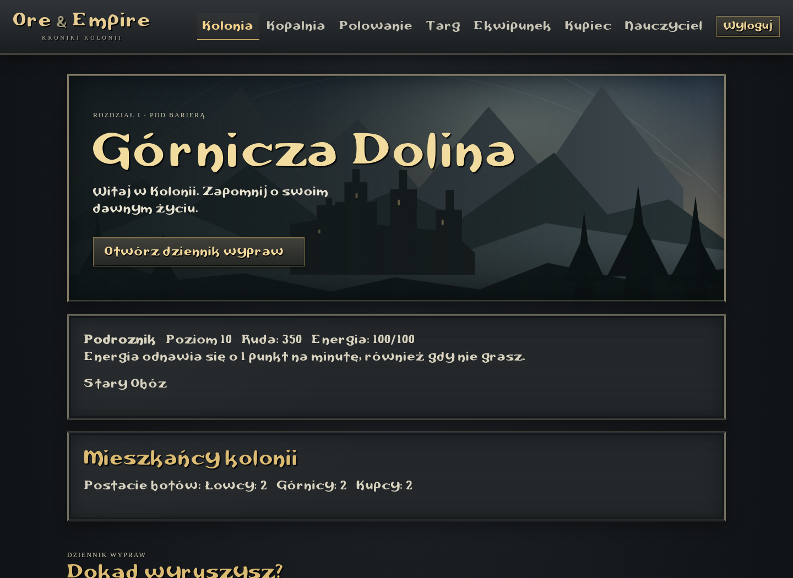
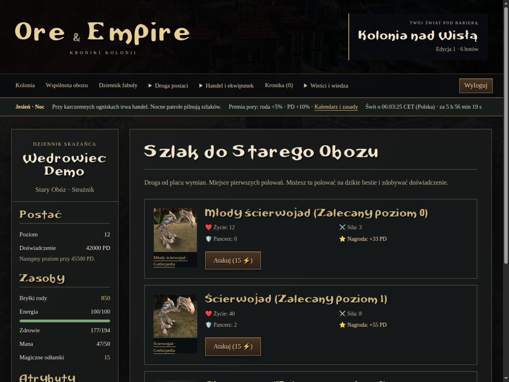
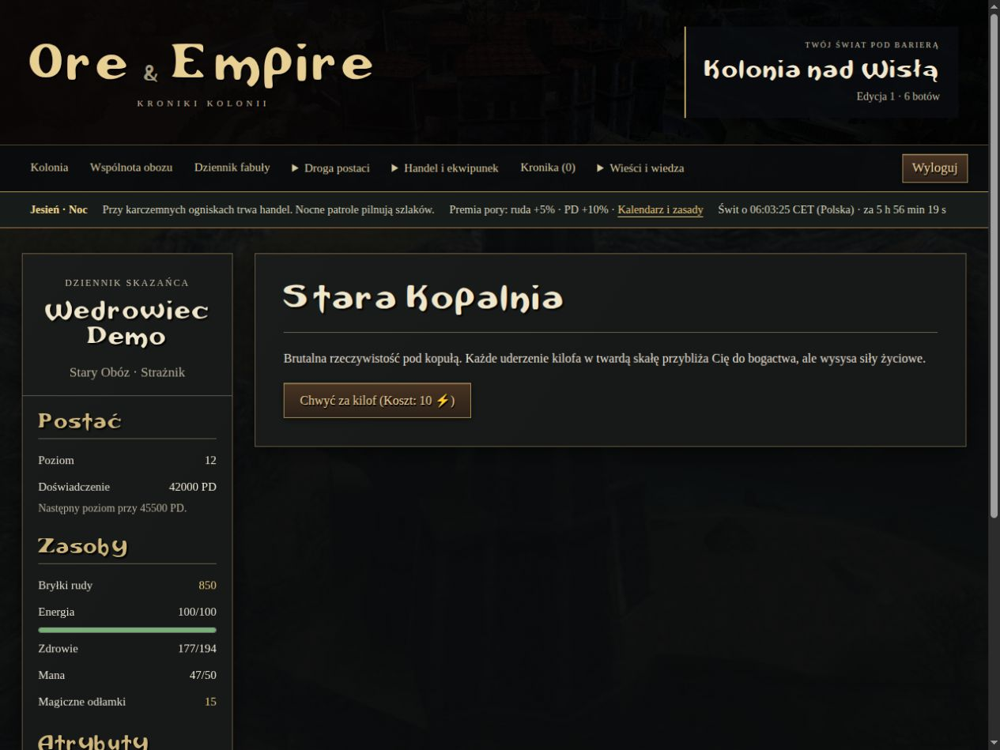
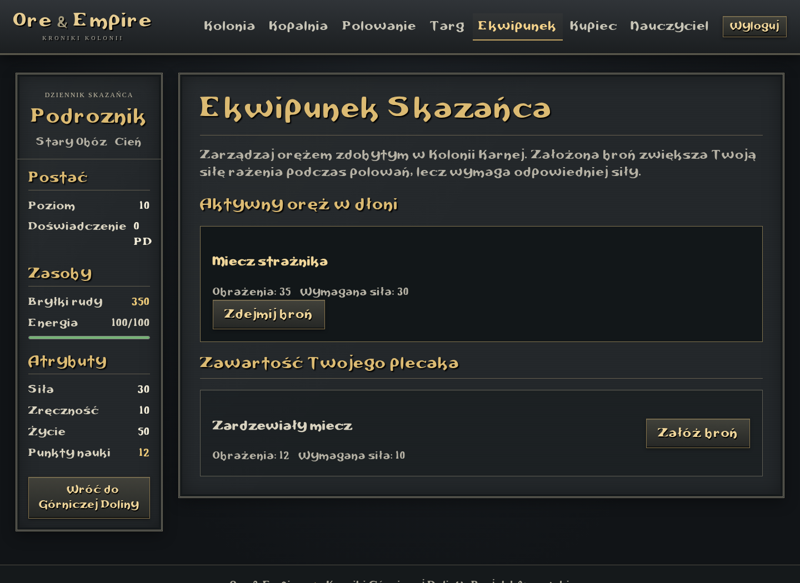
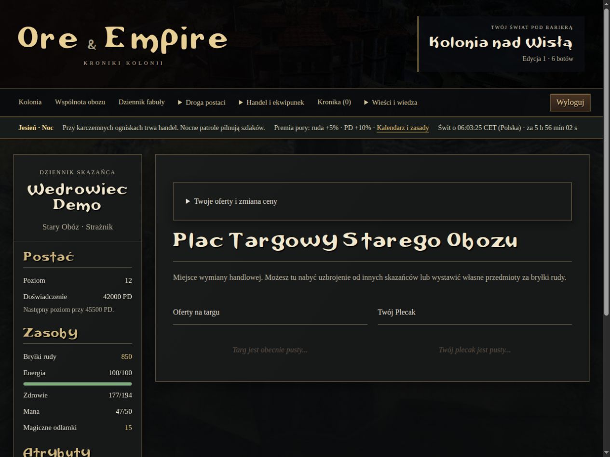
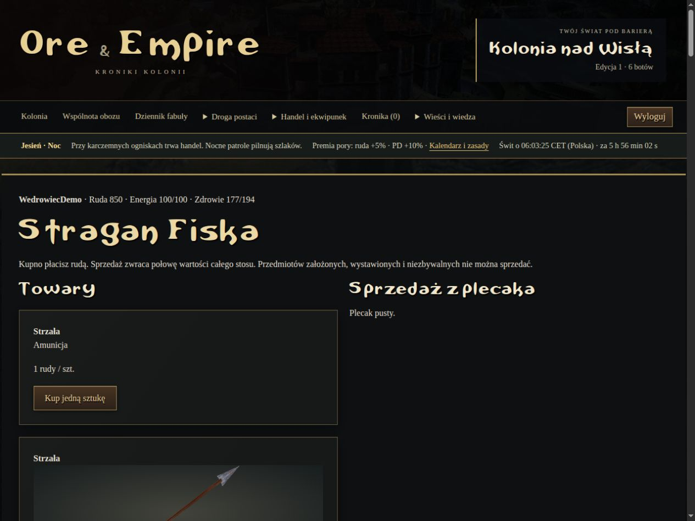
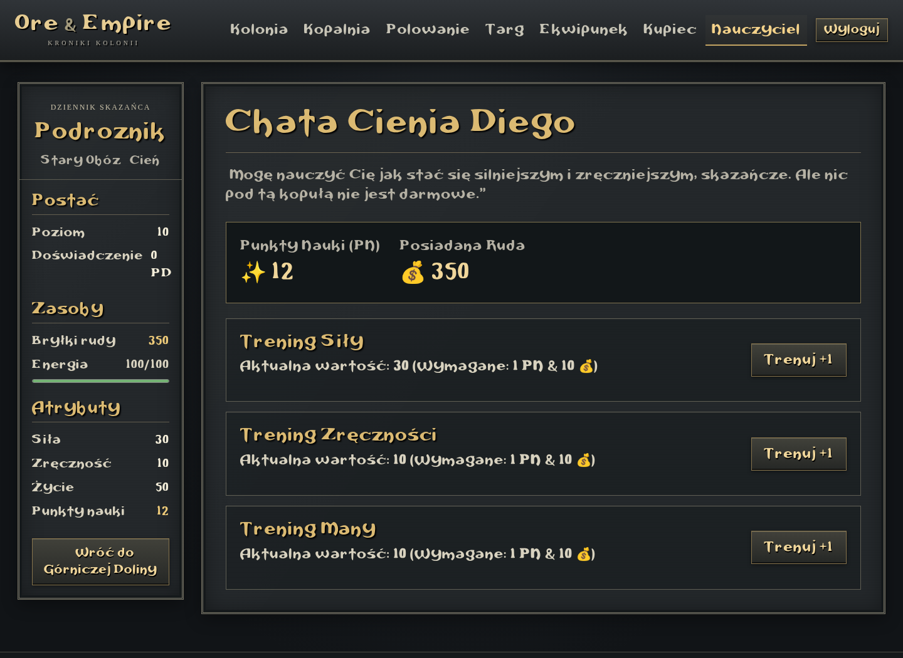
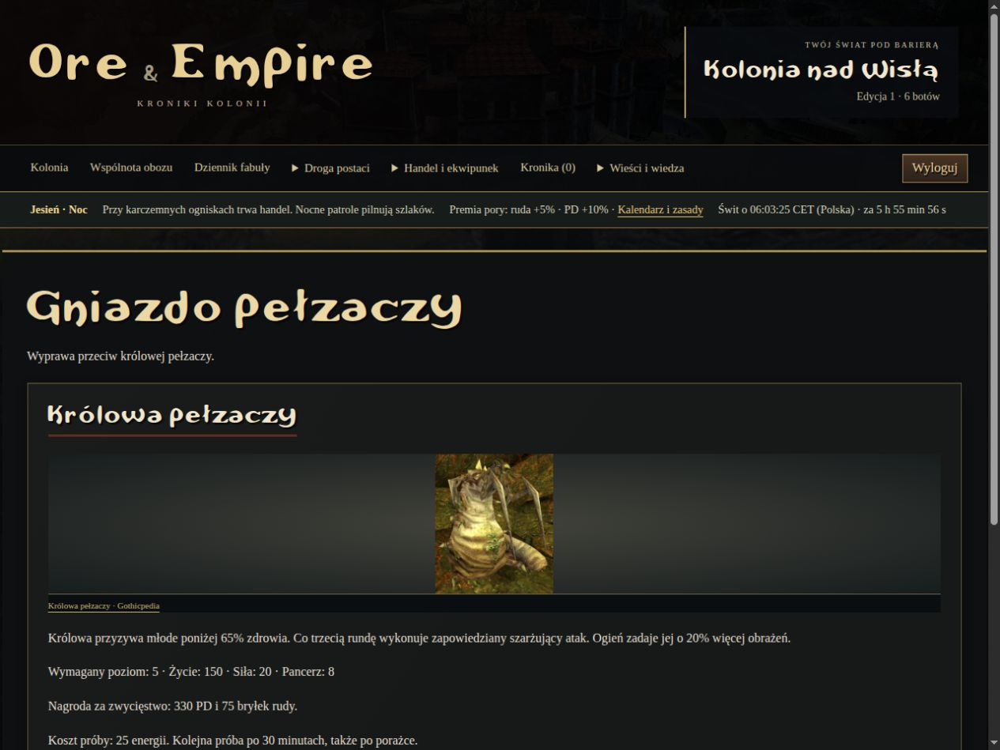
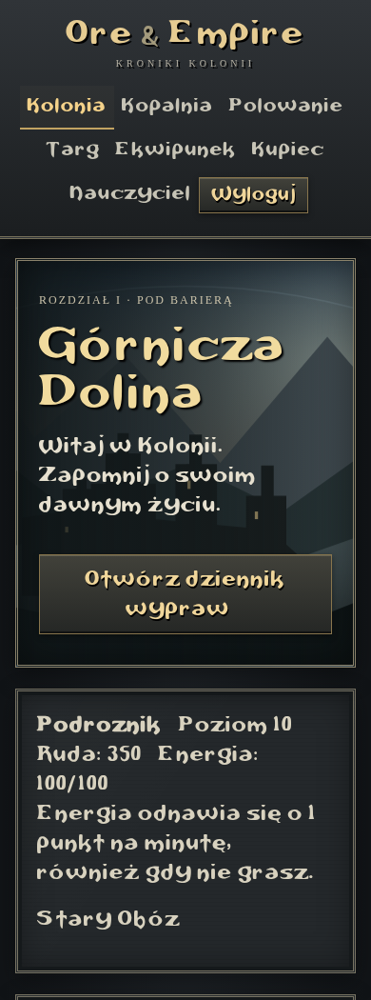

## Pierwsza pełna wersja lokalna

Uruchom `python play.py --bots 6 --port 8001`, otwórz `http://127.0.0.1:8001/` i zarejestruj zwykłą postać. [Przewodnik całej pętli gry](docs/FIRST_PLAYABLE.md) opisuje drogę od pierwszej zmiany do finału sześciu rozdziałów i sali chwały. [Pory dnia i roku](docs/WORLD_CLOCK.md) wyjaśniają czterogodzinną dobę i sezonowe wydarzenia. Publiczny hosting pozostaje osobnym etapem.

# Ore & Empire: Colony Chronicles

**Ore & Empire** is a local-first text browser RPG inspired by *Gothic*, with a bot-populated colony and optional multiplayer over LAN or public hosting.

This is a 100% fan-made project created out of passion. The game is still heavily in development, which means features are constantly changing, and new ones are being added regularly. 

## Screenshots and main screens

A stone-and-metal interface inspired by Gothic I, with gold menu highlights and
a locally served Gothic II font. The Polish UI shares the same navigation and
character sheet across gameplay screens, keeping your ore, energy and attributes
close at hand.

These screenshots show the current panel with a **demo character and sample
items**, captured at 1440 × 1050 on desktop and 390 × 1050 on mobile. Character
values illustrate the interface, not the starting balance. The landscape is an
original project illustration; Gothicpedia images are not included in these
captures. See [asset sources](docs/ASSETS.md) for details.

### Colony — your journey starts here

**Kolonia** is the hub for exploring Górnicza Dolina. Check your level, ore and
energy, choose a camp, and see the colony's bot population. The expedition
journal below lists destinations with their level and camp requirements, so you
can see which routes are open and what still needs to be unlocked.



<details>
<summary><strong>Hunting — choose your next opponent</strong></summary>

**Polowanie** shows the creatures available in the current location, their level,
health, strength, armour and experience reward. Each attack costs 15 energy;
the battle report records the exchange of blows and the result. The character
sheet stays visible alongside the encounter list.



</details>

<details>
<summary><strong>Mining — turn time and energy into ore</strong></summary>

**Kopalnia** is the colony's basic source of income. Start a shift for 10 energy,
watch the countdown, and claim the ore when the work finishes. You can leave the
screen while the timer runs and return to collect your reward.



</details>

<details>
<summary><strong>Inventory — prepare your equipment</strong></summary>

**Ekwipunek** separates the weapon in your hand from the items in your backpack.
Compare damage and strength requirements, equip a suitable weapon, or remove it
before changing your loadout. Equipped weapons contribute to your hunting damage.



</details>

<details>
<summary><strong>Marketplace — trade with the colony</strong></summary>

**Targ** places market offers beside your own backpack. Buy equipment from other
characters, set a price for your items, and withdraw your unsold listings.
Seller names and bot role labels help identify the colony's traders; prices are
shown in ore.



</details>

<details>
<summary><strong>Merchant — buy and sell at the NPC stall</strong></summary>

**Kupiec** provides a separate NPC shop with equipment prices, damage and strength
requirements. Buy an upgrade from the merchant's stock or sell spare gear for
50% of its base value. Your ore balance remains visible in the character sheet.



</details>

<details>
<summary><strong>Training — spend learning points on your character</strong></summary>

**Nauczyciel** shows your learning points and ore alongside training options for
strength, dexterity and mana. Each attribute increase costs one learning point
and 10 ore. Unavailable actions are disabled until you meet the requirements.



</details>

<details>
<summary><strong>Boss expeditions — weigh the risk before entering</strong></summary>

The expedition screen presents the boss's attributes, entry level, fixed rewards
and energy cost before you commit. Each attempt costs 25 energy and starts a
30-minute cooldown, including defeats. After a fight, the same screen shows your
last result, rewards and saved combat report.



</details>

<details>
<summary><strong>Mobile — the colony on a smaller screen</strong></summary>

Navigation wraps to fit the viewport, location cards form a single column, and
character panels stack above the main content. The same Gothic styling and game
actions remain available on mobile.



</details>

## Local game first

The default experience is one human playing a local colony populated by bots.
Human accounts, trading and permissions remain compatible with LAN and public
hosting. AI/ML policies are a later extension; current bots are rule-based and
need no Internet service or API key.

Requires Python 3.12+ (SQLite is included with standard Python).

```sh
python3 -m venv .venv
. .venv/bin/activate
python -m pip install -r requirements.txt
python play.py
```

On Windows activate with `.venv\Scripts\activate` instead. `play.py` creates a
local `.env` with a random development key only if it is absent, applies
migrations, seeds missing merchant stock and starts six bots alongside the web
server. Register a character in your browser at the address printed by the
command (default port 8000 on this machine). Ctrl+C stops both the server and
bots; SQLite progress is kept in `db.sqlite3`. Restarting reuses existing accounts,
items, prices and balances. Do not start another bot scheduler at the same time.

```sh
python play.py --bots 12 --interval 5 --port 8000
python play.py --bots 0  # human-only mode
```

`--bots` selects up to that many active bot profiles and creates missing numbered
accounts, up to 20. Existing roles and player progress are preserved. HTTP
requests and bot rounds execute sequentially in this local server, avoiding
simultaneous bot/web writes to SQLite. This favors a small local world, not high
request throughput. Bot rounds run while the command is open, including when
your browser is closed; no offline bot catch-up is simulated after shutdown.
Energy still recovers with elapsed time.

### Optional LAN and public hosting

For trusted LAN play, add your machine's LAN IP to `ALLOWED_HOSTS` in `.env`
(for example `ALLOWED_HOSTS=localhost,127.0.0.1,192.168.1.50`) and run:

```sh
python play.py --host 0.0.0.0
```

Other players connect to that machine's LAN IP and port using separate accounts.
Allow the selected port in your local firewall if necessary. Default startup
binds to loopback; it does not expose the game to the network automatically.

For public hosting, use `ore_empire.wsgi:application` with a production WSGI
server, explicit hosts, HTTPS, `DEBUG=False`, static-file serving and backups.
Run the bot scheduler separately there; `play.py` is a local/LAN server. Networked
accounts and game services are retained, but production deployment and PostgreSQL
configuration/load testing remain a separate milestone.

For code development without automatic bots, `python manage.py runserver` still
works after migrations and `python manage.py seed_world`.

### Play loop

Start with 50 ore and 100 energy. Mining takes 15 seconds and 10 energy; claim the
reward when it finishes, including after leaving the page. Hunt young scavengers
to gain your first experience, buy/equip a weapon, then train attributes with
learning points and ore. Energy recovers by one point per minute, capped at 100;
recovery is calculated on your next request. Choose your camp in the colony
screen; the current UI allows one permanent choice. Locations show level and
camp requirements, which the server also enforces. Locations currently reuse
the mining, hunting, training and trading screens; unique quests come later.

### Boss expeditions

The colony directory includes two solo boss encounters: the minecrawler queen
(level 5) and an ancient swamp creature (level 8). Each attempt costs 25 energy
and starts a per-character, per-boss 30-minute cooldown, including defeats.
Victories grant fixed experience and ore; defeats grant neither. Reports and
actual rewards are saved in the database and are visible only to their player
and administrators. Gates, costs, rewards and cooldowns are enforced on the
server. Mining must finish before starting an expedition.

### Baseline bots and market data

```sh
python manage.py run_bots --create 3 --limit 3
python manage.py run_bots --limit 3
```

The manual command is an alternative to the automatic local launcher. Each
invocation runs at most one action per selected bot. Bots have ordinary
starting resources, unusable login passwords and use the same services as human
players. New numbered accounts rotate between hunter, trader and miner roles. These are
preferences: every role can mine, fight, train, run timed errands and join a camp.
Bots choose survivable encounters from unlocked locations, complete promotion
objectives, recover resources and buy useful shard-shop products.
Role labels appear on market offers and the colony directory shows the population.
Bots buy market offers up to 120% of NPC value, list at 110%, and hold at most six
items through their policy. Repeated calls or an external scheduler are
required when using the manual command; `play.py` runs its own periodic rounds.
Avoid overlapping scheduled runs.
`--create` reuses designated bots and refuses to convert a human account.

These are **rule-based baseline bots**, not an LLM or trained AI. The immutable
observation and allowlisted action interface in `characters/bots.py` is the
extension point for future AI policies. No AI credentials are required yet.

Create an administrator with `python manage.py createsuperuser`. Staff can open
**Stan rynku** from the navigation bar for aggregate player-to-player trade
volume, recent transactions and full CSV export. CSV includes UTC timestamps,
blueprint/player IDs, bot flags and actual paid prices; it excludes usernames.
NPC trades and listing/cancellation events are not yet part of this dataset.
Trade history begins with this migration; earlier trades cannot be reconstructed.
The same staff monitor now records bot decisions and exports them separately as
CSV: schema version, immutable observation, role, action, target, success and
actual ore/energy/health/shard deltas. Action execution and its record commit together. Waits
are included; unexpected exceptions roll back the action. Data starts at migration
0008; schema 2 expands observations and outcomes. Rest is sampled at five-minute
intervals, while non-rest actions retain full history. Ore deltas include trades, so they do not measure currency
creation. ML forecasting remains a later milestone after collecting enough observations.

### Validation

```sh
python -m pip check
python manage.py check
python manage.py makemigrations --check --dry-run
python manage.py test
```

Tests cover account isolation, economy rollback, duplicate purchases, energy,
mining claims, location gates, bot limits and staff-only market data. PostgreSQL
row-lock behavior and concurrent production load still need separate validation;
SQLite tests do not establish concurrent multiplayer readiness.

See [the development roadmap](docs/ROADMAP.md) for milestones and remaining work.


---

## Feature Roadmap

Here is the current state of the features:

*   [x] **Item Marketplace** - A player-driven trading hub for buying and selling gear.
*   [x] **Hunt Mechanics** - Turn-based text battle loop against monsters.
*   [x] **Timed Actions** - Asynchronous mining work timers in the Old Mine.
*   [x] **Camps & Guilds** - Database architecture ready for faction progression.
*   [x] **Main Locations** - Adding all the iconic places from the original game.
*   [x] **Gated Progression** - High-level areas locked by level or camp requirements.
*   [x] **Boss Mechanics** - Epic encounters.
*   [X] **NPC Merchants** - Trade with merchants. Buy equipment or sell loot for 50% value.
*   [x] **Equipment System** - Equip items from the inventory, tracking strength requirements.
*   [X] **Leveling & Teachers** - Spend Learning Points (LP) and ore at camp mentors to permanently train attributes.
*   [ ] *And much more to come! :D*

---

## Interface and continuous integration

The Gothic I inspired interface shares a local stylesheet and a locally served
Gothic II font across game screens. It includes responsive layouts, keyboard focus
states, active navigation, and an asset credits page. See [asset sources and the
Gothicpedia importer](docs/ASSETS.md) for image setup.

GitHub Actions runs configuration checks, migration consistency, the Django test
suite and static asset collection on pushes to `main` and
`feature/playable-colony`, and on pull requests. Static output is uploaded as a
build artifact. Deployment is not configured: there is no production target or
hosting credential in this repository.

Run the same checks locally:

```sh
python manage.py check
python manage.py makemigrations --check --dry-run
python manage.py test --noinput
python manage.py collectstatic --noinput
```

### Expanded Gothic I world

The searchable bestiary contains 53 creature types and variants; the queen and
Sleeper appear as bosses. 41 main destinations have local Gothicpedia artwork,
level requirements and distinct encounter rosters. See [world coverage](docs/WORLD.md)
for sources and the scope of this browser adaptation.

### Camp quests and promotion

Open **Obóz i zadania** to compare the three camp hierarchies. Each camp has six
ranks, with permanent warrior/mage branches and an original promotion quest for
each rank. Accept one quest, complete its mining/hunting/training/boss objectives,
then meet the level, attribute and ore requirements to promote. Progress starts
when accepting; only successful server-side actions count. Abandoning a quest
loses its progress. Promotion and payment happen once in one transaction.

The Old Camp castle requires tier 1; the Water Mages headquarters and Brotherhood
temple require tier 2 plus their corresponding camp and entry level. Base training
remains available in the New Camp. Mage ranks are implemented; spell combat is a
later milestone. See [camp progression](docs/CAMPS.md) for the complete requirements.

### Timed errands, events, rankings and shard shop

The colony now includes 11 repeatable timed errands, persistent health and passive
health/energy recovery. Earn magic shards from errands, collect event bonuses and
buy Gothic-themed weapons or immediate recovery drinks. Global and camp rankings
can include humans, bots or both. Seasonal, holiday, random and manual events share
an editable calendar. See [living-world rules](docs/LIVING_WORLD.md).

For local operator access, run `python play.py --setup-admin`. Read the generated
credentials in the ignored `.admin-access.json`, sign in, and open **Zarządca**.
The game-master panel can restore resources, grant equipment/shards and edit stats;
full Django administration also manages accounts, events, errands and shop stock.
No administrator password is committed to the repository.

### Autonomous bot scheduler

`play.py` runs the full bot loop while the local server is open, even with the
browser closed. Progress is saved; resources recover with elapsed time after a
restart. Gameplay actions are not replayed for time spent with the server stopped.
The policies are autonomous rule-based players, not an LLM service.

For a separate web server, initialize the pool and run one scheduler instead:

```sh
python manage.py seed_adventures
python manage.py run_bots --create 6 --loop --interval 5
# Or a bounded batch (one action per bot per round):
python manage.py run_bots --limit 6 --rounds 10 --interval 5
```

Do not run a separate scheduler alongside `play.py` bots. The immutable observation
and allowlisted executor also cover camp advancement, boss objectives, errands and
shop purchases. Bots cannot mint ore/shards or call administrator operations.
