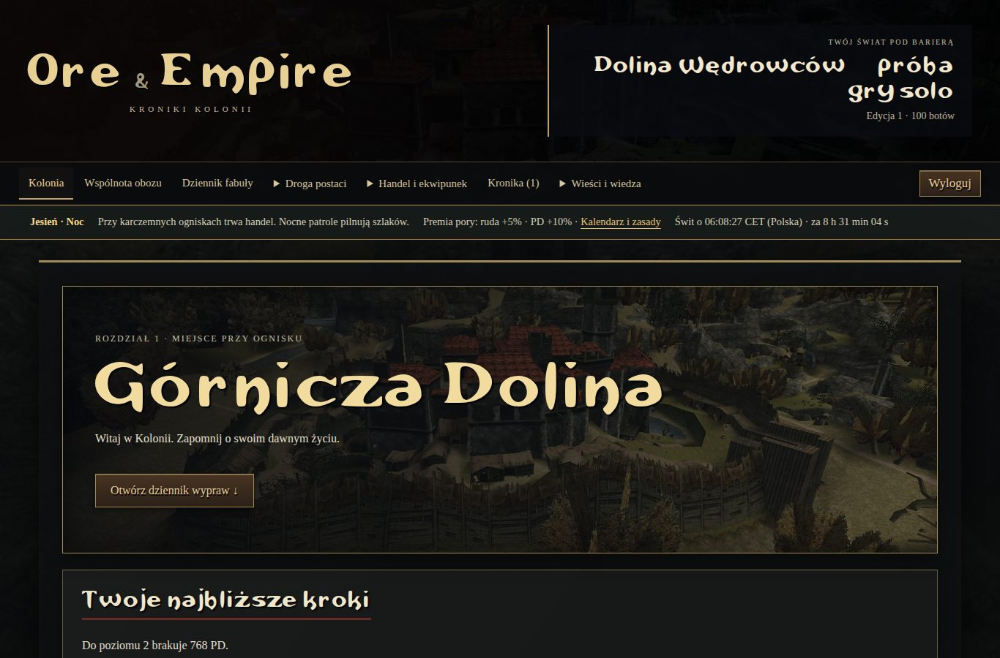
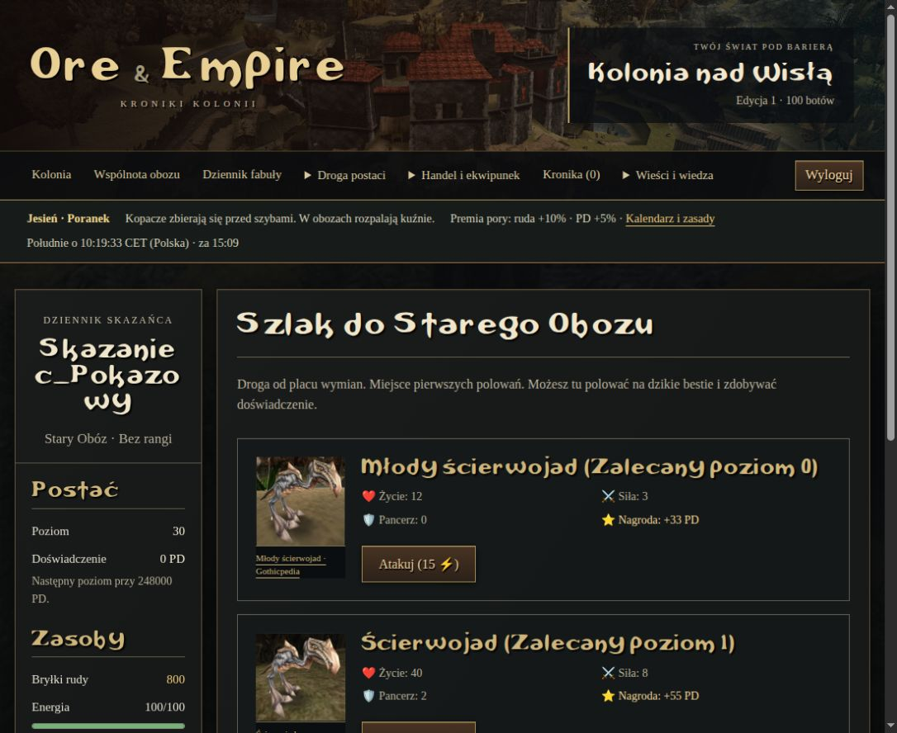
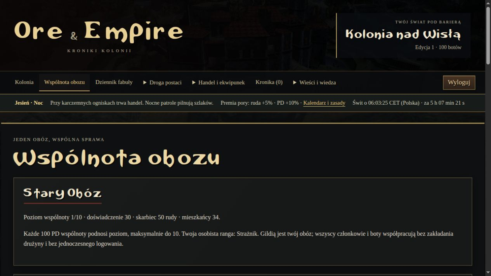
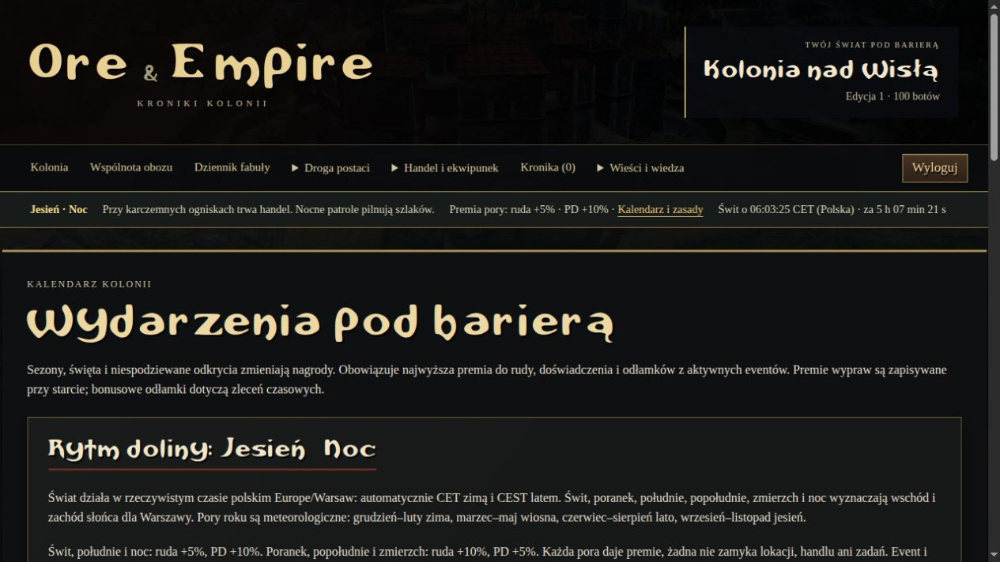
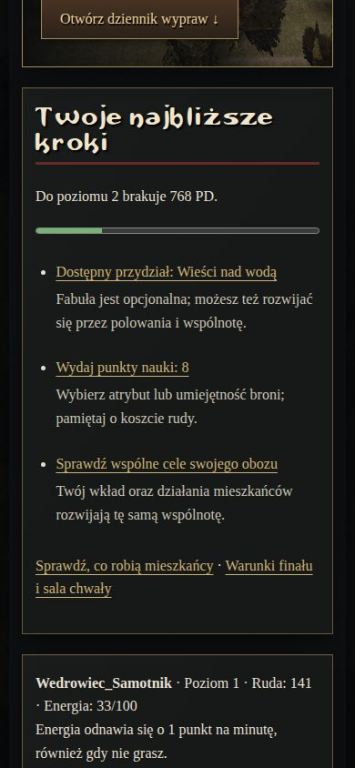
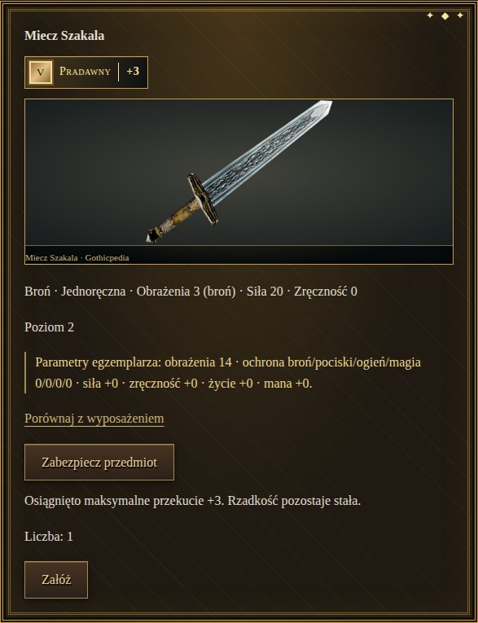

# Ore & Empire — Kroniki Kolonii

Fanowskie, polskojęzyczne RPG przeglądarkowe inspirowane Gothic I, II i III. Możesz grać solo w kolonię zaludnioną autonomicznymi botami: pracują, walczą, awansują, handlują i rozwijają wspólnoty obozowe. Boty są jawnie oznaczone i nie wymagają płatnego API AI.

**[Publiczna dokumentacja HTML — cała księga offline](docs/dokumentacja.html)**: stack, instalacja, restart, panel zarządcy, zasady gry, katalogi, screenshoty i raporty. Pobierz plik i otwórz go w przeglądarce; podgląd GitHuba pokazuje kod HTML.

## Uruchomienie lokalne

Wymagany Python 3.12 lub 3.13. W terminalu w katalogu projektu:

```bash
python3 -m venv .venv
source .venv/bin/activate
python -m pip install -r requirements.txt
python play.py --bots 125 --port 8001
```

Otwórz [grę lokalną](http://127.0.0.1:8001/). Nowa instalacja udostępnia `/inicjalizacja/`: wybierz nazwę serwera, 0–300 botów oraz własny login i hasło administratora. Do zwykłego przejścia zarejestruj osobne konto gracza. Po zapisaniu konfiguracji liczba botów pochodzi z panelu świata; `--bots` służy do wartości początkowej. Ctrl+C zatrzymuje launcher, zapis pozostaje.

Nie uruchamiaj drugiego schedulera na tej samej bazie. Wersja lokalna używa SQLite i jednego procesu obsługującego graczy i boty. Opcjonalny profil produkcyjny, PostgreSQL i procedury wdrożenia są w [dokumentacji operatora](docs/PRODUCTION.md).

Nowość: **pięć postaci na konto**, kreator po rejestracji, wymagania fabularne obozów i przywileje rang. [Zasady oraz plan Kolonia + Khorinis](docs/CHARACTERS_AND_WORLDS.md). **Khorinis jest już grywalne przed połączeniem**: 29 definicji fabuły, trzy frakcje i własna pętla. [Zakres paczki i otwarcie serwera](docs/KHORINIS.md). Jarkendar pozostaje zamknięty do przyszłego połączenia po obozowym Śniącym.

## Co możesz przejść

- Sześć rozdziałów i 41 jednorazowych definicji fabularnych; 27 zadań prowadzi daną ścieżkę do przygotowania finału, dostępny jest także epilog zależny od wyboru.
- Osobisty finał od poziomu 30, trzej bossowie z fazami i trofeami oraz trwała sala chwały. Finał bota nie zamyka świata.
- Trzy obozy jako gildie: osobiste rangi, wspólne zadania, skarbiec, ulepszenia i asynchroniczny boss.
- Polowanie, kopalnie, ekwipunek, rzeczywisty rynek, cztery receptury kowalstwa/alchemii i dziewięć zaklęć jako runy/zwoje.
- 44 zlecenia czasowe, wyzwania dzienne/tygodniowe, reputacja, osiągnięcia i odłamki zdobywane w grze. Bez realnych płatności.
- Siedem osobowości botów, sesje w czasie polskim i jawne symulowane zakupy odłamków — [szczegóły](docs/BOT_PERSONALITIES.md).
- 17 ofert itemshopu z limitami przyspieszania postępu, racjonalna wycena i ochrona wyposażenia botów.
- Karczma na jeziorze, publiczna kronika działań botów, prywatne raporty i powiadomienia.
- Rzeczywisty **czas polski `Europe/Warsaw`**, automatyczne CET/CEST; świt i noc według Słońca dla Warszawy, pory roku meteorologiczne. 12 wydarzeń miesięcznych, trzy coroczne i losowe odkrycia; żadna pora nie blokuje gry.
- Panel zarządcy, inicjalizacja/reset świata z zachowaniem administratorów, prywatne kopie i sprawdzane odtwarzanie.

Rozwój MMORPG od początku gry: [łupy, nazwane rangi rynsztunku i 100 stopni wart](docs/LOOT_AND_ENDGAME.md). Świat nadal żyje po osobistym finale, z miesięcznym rankingiem wart. Limit mieszkańców podniesiono do 100; [pomiar i zasady wydajności](docs/BOT_PERFORMANCE.md).

Ostatni przegląd grywalności: [zwykła sesja, trzy buildy i wnioski](docs/SOLO_PLAYTEST.md). Trening obejmuje cztery typy broni, kupiec ma filtry i zakupy zapasów, a polowanie pokazuje przygotowanie oraz ryzyko.

Nowość: [44 zlecenia w sześciu kategoriach](docs/ADVENTURES.md) oraz osobne gotyckie ramy i plakietki pięciu rzadkości przedmiotów.

## Aktualne ekrany

Zrzuty pokazują osobny świat demonstracyjny i zwykłe konta testowe; sklep, wybór postaci i wspólnotę odświeżono 9 listopada 2026, pozostałe mają daty w manifeście. Stan postaci na screenach nie jest obietnicą zasobów startowych. Grafiki Gothicpedii i czcionka są lokalne; [źródła](docs/ASSETS.md).



| Polowanie | Wspólnota obozu |
|---|---|
|  |  |

| Kalendarz sezonów | Widok mobilny |
|---|---|
|  |  |

[Pozostałe aktualne ekrany](docs/SCREENSHOTS.md).

## Dokumentacja

- **[Instrukcja całej gry](docs/GAME_GUIDE.md)** — start, zasoby, rozwój, obozy, handel, magia, finał i administrator.
- **[Pełny katalog zawartości](docs/GAME_CONTENT.md)** — lokacje, potwory, rangi, zadania, receptury i zaklęcia.
- **[Wszystkie święta i wydarzenia](docs/EVENTS.md)** — daty, bonusy, losowanie i zasady nakładania.
- [Czas polski i zmiana czasu](docs/WORLD_CLOCK.md), [start i reset świata](docs/WORLD_MANAGEMENT.md), [kopie zapasowe](docs/BACKUPS.md).
- [Indeks całej dokumentacji](docs/INDEX.md), [bieżąca roadmapa](docs/ROADMAP.md).

Dokumentacja opisuje domyślną zawartość. Administrator może zmienić ceny, receptury i wydarzenia; w takim świecie obowiązują aktualne wymagania widoczne w grze.

## Konto administratora

Nie ma publicznego, wspólnego hasła. Na istniejącej instalacji możesz utworzyć własne konto:

```bash
python manage.py createsuperuser
```

Podaj login i hasło interaktywnie, a następnie zaloguj się do `/konto/logowanie/` i otwórz `/zarzadca/` lub `/admin/`. `python manage.py changepassword TWOJ_LOGIN` zmienia zapomniane hasło lokalnie.

Alternatywnie `python manage.py create_game_admin --username TWOJ_LOGIN` generuje hasło w prywatnym `.admin-access.json` (uprawnienia 0600, ignorowany przez Git). Ten plik, `.env`, baza, backupy i rzeczywiste dane logowania nigdy nie powinny być publikowane. W repozytorium nie ma danych dostępu do prywatnego świata.

## Testowanie

[Przegląd błędów i scenariusze regresji](docs/BUG_AUDIT.md) opisuje zabezpieczenia transakcji, amunicję botów, odbiór nagród i wyniki końcowej symulacji.

```bash
python manage.py check
python manage.py makemigrations --check --dry-run
python manage.py validate_content
python manage.py test --noinput
python manage.py simulate_release --report /tmp/nowa-symulacja.json
```

Symulacja używa izolowanej bazy. Przechodzi kampanię graczem i trzema obozami botów, wspólną sesję handlową, próby nadużyć oraz testy buildów i czasu. Przyspiesza czas testowy, bez nadawania zasobów w przejściu od zera. [Aktualna symulacja czasu polskiego](docs/reports/czas-polski-2026-11-06.json). [Raport poprzedniej pełnej wersji](docs/reports/pierwsza-pelna-edycja-2026-11-05.json) jest zachowany jako wynik historyczny wcześniejszego zegara; aktualny zegar opisuje WORLD_CLOCK.md. CI obejmuje Python 3.12 i 3.13.

Projekt fanowski, niezwiązany oficjalnie z właścicielami marki Gothic. Statystyki i fabuła są adaptacją przeglądarkową, nie wierną kopią oryginalnej gry.

Nazwane rangi sprzętu i pełny katalog 522 kodów G1 opisano w [katalogu i grafikach](docs/ITEM_PACKS.md). Fabuła wyznacza wymagania członkostwa i awansów; jest też osobistym przydziałem mieszkańca; rozwój rynsztunku zaczyna się od pierwszych łupów.



Opcjonalna instalacja PostgreSQL, import zapisu i ochrona przed dwoma schedulerami: [POSTGRESQL.md](docs/POSTGRESQL.md). Lokalny zapis nadal domyślnie używa SQLite.

Profil serwera, HTTPS, staging, ochrona kont i procedury wdrożenia/odtworzenia: [PRODUCTION.md](docs/PRODUCTION.md).

Opcjonalne lokalne polityki AI, bez płatnego API i z regułami jako domyślną polityką: [LOCAL_AI_POLICIES.md](docs/LOCAL_AI_POLICIES.md).

### Wygoda rynsztunku i targu

Cenny sprzęt można zabezpieczyć przed sprzedażą, rozbiórką i zużyciem w zadaniach.
Porównywarka pokazuje efektywne różnice oraz wymagania przed założeniem; przy
pierścieniach wybierasz zastępowany slot. Targ ma filtry, ceny jednostkowe i osobne
strony ofert, własnych ogłoszeń oraz plecaka. [Ekwipunek](docs/EQUIPMENT.md) ·
[zasady targu](docs/MARKET_POLICY.md).

### Rzadkość zdobywasz z łupem

**Niewykończony → Mistrzowski → Nasycony magią → Runiczny → Pradawny**.
Rzadkość egzemplarza pozostaje stała. Kuźnia osobno podnosi jego przekucie do **+3**.
Rzadkości nie można wykupić kolejnym przekuciem. [Drop, koszty i zachowanie starych zapisów](docs/LOOT_AND_ENDGAME.md).
