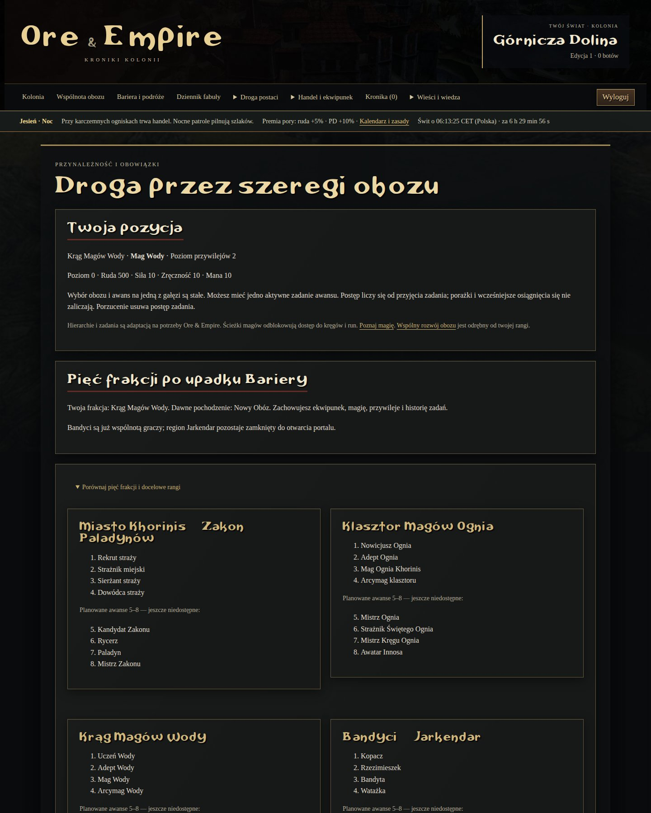
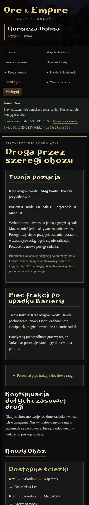
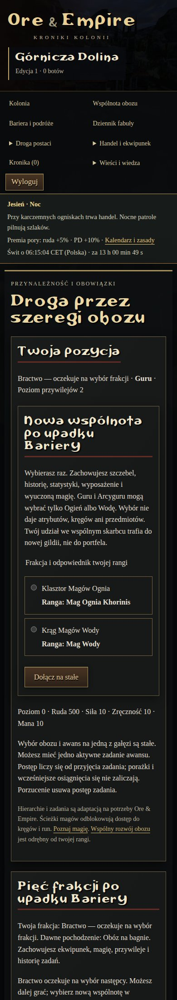
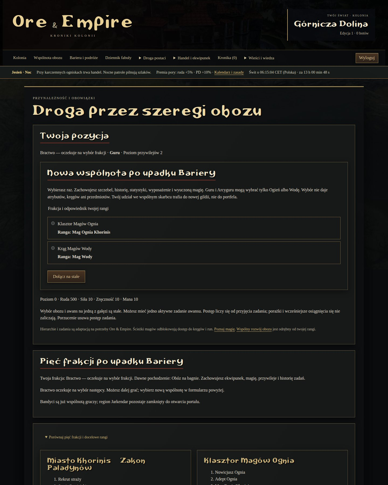

# Obozy jako gildie — etap 1

> **Decyzja projektowa 11 XI 2026:** konto premium wycofane; Jarkendar publiczny po połączeniu. Docelowe pięć frakcji, sukcesję dawnych rang i podwojenie awansów opisuje [aktualna roadmapa](ROADMAP.md). Sukcesja pięciu frakcji jest wdrożona w0049; wybór Bractwa działa od0050, wyższe awanse i portal nadal są planowane. Starsze sekcje poniżej opisują historię.

Gildią jest istniejący Stary Obóz, Nowy Obóz albo Bractwo na bagnie. Nie ma oddzielnej rekrutacji, drużyn ani wymogu jednoczesnej obecności. Przynależność `camp` daje członkostwo; dotychczasowe `guild` oznacza **osobistą rangę** (np. Cień), nie nową organizację. Dołączenie do obozu nie zmienia wcześniejszych questów, sprzętu i poziomu. Na razie istnieje jeden lokalny świat; zakres edycji pozostaje #15/#34, współbieżność serwera #19.

`/wspolnota/` pokazuje wspólny poziom 1–10, PD, skarbiec, dzienne zlecenie, ulepszenia i 30 ostatnich wkładów. Każde 100 PD wspólnoty daje kolejny poziom do 10. Rotacja trzech małych zleceń jest deterministyczna na dzień i obóz. Reset o północy czasu polskiego; cele są zamrażane przy pierwszym zaliczonym działaniu, a stary postęp pozostaje w historii. GET nie tworzy ani nie rozlicza projektu. Bez retroaktywnego zaliczania dawnych sukcesów. Wygrane polowanie i odbiór zmiany w kopalni przechodzą przez serwis gry i automatycznie liczą wkład członka; porażka ani ponowienie rozliczonego request_key nie dodają go ponownie. Działania bez obozu i członków innych obozów nie zasilają projektu. Liczą się wszystkie wygrane polowania, żeby nowe postacie miały użyteczne zajęcie.

Za cały projekt obóz dostaje raz 30 PD i 50 rudy skarbca, niezależnie od liczby członków. To nagroda wspólna, bez odłamków i automatycznych wypłat osobistych. Boty liczą się na tych samych zasadach; okresowo wpłacają 10 własnej rudy przy portfelu co najmniej 250 i skarbcu poniżej 100, lub kupują dostępne ulepszenie przez tę samą allowlistę. Polityka baseline-9; baseline-7/8 nadal odtwarzalne. Nie dostają skryptowych dopłat do statystyk/skarbca.

Wpłata 1–10000 rudy posiada klucz UUID i trwały wpis: powtórzenie z tym samym kluczem nie pobiera pieniędzy drugi raz, zmiana kwoty jest odrzucana. Skarbiec nie oferuje wypłat prywatnych. Odpowiednia ranga osobista odblokowuje zakup kolejnych poziomów; członek może kupić wyłącznie jedno ze zdefiniowanych, korzystnych dla wszystkich ulepszeń. Kolejny poziom N kosztuje 100×N rudy ze skarbca i wymaga poziomu obozu N+1, maksymalnie 3. Stary formularz z innym oczekiwanym poziomem nie może dokupić kolejnego poziomu.

- Szkoła: trening atrybutu tańszy o N rudy (10 → 7 dla samej szkoły, do 5 łącznie z rangą). Nie dotyczy opłaty nauki kręgów magii.
- Magazyn: +N rudy na rzeczywiście odebraną zmianę, po mnożnikach eventu.
- Warty: +N ochrony przed bronią/pociskami podczas walki, bez nadpisywania bazowych statystyk. Nie zwiększa ochrony przed ogniem/magią.

Ledger portfeli nadal rejestruje wpłatę jako odpływ z portfela; **nie jest to zniszczenie rudy w skali świata**, bo skarbiec ma oddzielny zapis i kronikę. Nowe 50 rudy projektu jest emisją do skarbca; wykup ulepszenia jest jego ujściem. Nie należy porównywać samej sumy portfeli z pełną gospodarką bez uwzględnienia skarbców. Administratorzy nadal mogą zmieniać przynależność w god-mode; wcześniejszy wkład pozostaje zapisany przy dawnym obozie, a nowe działania i bonusy należą do aktualnego.

Testy: izolacja obozów, wspólna realizacja przez ludzi/boty, retry walk/darowizn, koszty, bramki ulepszeń, pochodne bonusy, reset według czasu polskiego oraz pełny rollback przy błędzie rozliczenia. Backup obejmuje również wspólnoty, projekty i wkład. Wspólni bossowie działają (#51), podobnie osobiste wyzwania, reputacja i osiągnięcia (#21).

Od migracji 0042: [pięć postaci na konto, obowiązkowe progi fabularne, przywileje rang i aktualny plan dwóch serwerów](CHARACTERS_AND_WORLDS.md).

Od migracji 0043: [równoległe Khorinis, własna historia mieszkańca, trzy frakcje i izolacja serwerów](KHORINIS.md). Jarkendar jest zamknięty do połączenia światów.

## Związek najemników po upadku Bariery — 0046/0047

Nowy Obóz i Najemnicy Onara tworzą wspólną wspólnotę Lee i Onara. Kody historycznego członkostwa, osobiste rangi, osiągnięcia oraz oba rekordy gildii zostają zachowane. Nowe projekty, wpłaty, premie i wyprawy korzystają z głównej wspólnoty Nowego Obozu. Przy jednorazowym połączeniu skarbce są sumowane, dawny skarbiec Onara zerowany (bez zmiany łącznej rudy), PD łączone, a ulepszenia zachowują wyższy dotychczasowy poziom. Audyt zapisuje kwotę i identyfikatory. Stare wyprawy i ich nagrody pozostają rozliczalne pod dawnymi ID.

Wspólna hierarchia odpowiada szczeblom 0–4: **Robotnik wspólnoty → Zbrojny → Najemnik → Weteran szlaków → Dowódca Związku**. Dotychczasowy wyższy szczebel nie jest odbierany. Dalsza ranga `alliance_rank` nie przepisuje historycznego kodu rangi. Najpierw wymagany jest co najmniej drugi szczebel pierwotnej frakcji. Przejście na 3 wymaga poziomu 35, odebranego **Szlaku po upadku Bariery** i 500 rudy; na 4: poziomu 40, **Zagrożenia znad szczytu** i 1000 rudy. Awans działa dla graczy i botów przez ten sam serwis; daje zwykłe przywileje danego szczebla, bez powielania portfeli. Pozostałe wspólnoty zachowują własną historię i rozwój.

Formularz awansu Związku przesyła oczekiwany dotychczasowy szczebel. Powtórzenie starego formularza nie kupuje kolejnej rangi ani nie pobiera opłaty po raz drugi.

## Sukcesja pięciu frakcji — 0049

Bieżąca wspólnota jest zapisana w `FactionMembership`; rodzime `camp` i `guild` nadal prowadzą historyczne questy, wyposażenie i szkołę magii. Snapshot członkostwa przechowuje obóz i rangę z chwili sukcesji. Ogień z Kolonii i klasztoru współdzieli gildię Khorinis, Miasto zachowuje swoją, a Woda, Bandyci i Najemnicy otrzymują osobne wspólnoty przy historycznym regionie Kolonii. Ranking filtruje pięć bieżących frakcji, nie dawne obozy. Konto bez frakcji nie zostaje automatycznie wcielone.

Ruda i PD dzielą się proporcjonalnie do liczby dotychczasowych postaci przechodzących do każdego następcy (ludzie i boty, także postacie nieaktywne). Reszta całkowitoliczbowa trafia według największej reszty, przy remisie według kodu frakcji. Pusty Stary Obóz przekazuje środki Bandytom, pusty Nowy i Onar Najemnikom. Poziom wspólnoty i zakupione ulepszenia są dziedziczone bez obniżenia; przy łączeniu obowiązuje maksimum, nie suma. Zachowane historyczne rekordy gildii nie otrzymują już nowych wpłat/projektów. Ich przekazana ruda i PD są zerowane, stan sprzed operacji pozostaje w audycie.

W starszych zapisach Lee i Onar mają już połączony skarbiec: dzieli się go według łącznej liczby członków obu wspólnot. Historyczne PD Onara były już w puli Lee — nie naliczają się ponownie. Bractwo ma stan `PENDING`; jego skarbiec i wspólnota pozostają w depozycie do #126, zwykłe akcje nadal działają. Nie rekrutuje nowych członków po upadku Bariery.

Projekty, wpłaty i wyprawy zachowują oryginalne ID. Rozdzielane obozy archiwizują bieżące projekty i niedokończone wyprawy; następcy zaczynają własne, bez kopiowania postępu i nagród. Miasto i klasztor zachowują własne projekty. Za zakończoną dawną wyprawę można nadal odebrać nagrodę wyłącznie przy rzeczywistym dodatnim wkładzie; retry pozostaje jednokrotne. Nowe ataki/bonusy/wpłaty trafiają do bieżącej wspólnoty. Niedokończony dawny projekt nie wypłaca rekompensaty.

Historyczna ścieżka podstawowych questów pozostaje grywalna. Dojście do jej istniejącej gałęzi maga aktualizuje bieżącą frakcję na Ogień/Wodę; nie wykonuje ponownie sukcesji skarbców. Nie jest to swobodna zmiana gildii. Ukończone awanse Związku i dawnej drogi Wody zachowują przywileje; nowe zakupy awansu Związku są dostępne tylko Najemnikom. Osiem docelowych nazw jest pokazane w GUI, lecz nowe awanse5–8 realizuje dopiero #127. Bandyci istnieją jako frakcja, nie otwierają jeszcze regionu Jarkendar.

`FactionSuccession` jest unikalne dla wyścigu. Transakcja blokuje postacie i gildie w ustalonej kolejności, a audyt zapisuje liczby członków, stany źródeł i przydziały. Błąd cofa całość. Aktywacja nowego połączenia korzysta z istniejącej kopii i blokady zapisu. Uaktualnienie już połączonego zapisu wymaga kolejnej świeżej kopii z próbą odtworzenia i jest wznawialne przez worker lub polecenie `barrier_transition ID --resume --operator LOGIN`. Migracja0049 dodaje tylko schemat; nie dotyka danych osobistych ani nie pomija mechanizmu kopii. Wdrożenie na prywatnej bazie nie jest częścią tej iteracji.

Weryfikacja #125: [raport testów i ograniczeń](reports/sukcesja-frakcji-2026-11-11.json). Pakiet `quick` obejmuje teraz także sukcesję. Bieżące zadanie awansu jest przed historycznymi kartami, a porównanie frakcji można rozwinąć. Listy rankingów i mieszkańców pobierają członkostwo wraz z postaciami. Dzierżawa chroni aktualizację starego serwera przed równoczesną kopią, a błąd daje audyt i 60 sekund przerwy przed retry.

Początek widoku po sukcesji, komputer1440px:

Telefon390px:

## Jednorazowy wybór Bractwa — 0050, #126

Formularz w `/oboz/` pozwala przejść raz do nowej wspólnoty. Guru i Arcyguru wybierają Ogień/Wodę, pozostali członkowie Bractwa — wszystkie pięć frakcji. Zbieracz i Nowicjusz mają otwarty wybór. Powtórzenie tego samego wyboru jest bezpłatne i nie przenosi środków ponownie; inna frakcja jest odrzucana. Wybór wymaga zakończenia trwającej czynności oraz dokończenia albo świadomego porzucenia aktywnego zadania awansu przez dotychczasowy formularz. Nie kasuje zadania za gracza. Czekając, można normalnie grać.

Szczebel podstawowy i jego korzyści pozostają; postać bez rangi nadal nie ma zdobytej rangi. Nie przybywa poziomów, PN, atrybutów, kręgów, przedmiotów ani waluty osobistej. `camp`/`guild` nadal prowadzą historyczną kampanię; `FactionChoice` zapisuje oryginalną rangę i obie gildie. Kolejne rodzime awanse nie nadpisują wybranej frakcji. Po wyborze magicznym Nowicjusz kontynuuje drogę Guru; dawny Strażnik świątynny może zdobyć Arcyguru przez zwykłe wymagania, opłatę i zadanie. Po wyborze wojskowym Nowicjusz ma drogę Strażnika/Templariusza i nie może zostać Guru miasta. Awanse5–8 pozostają #127.

Wybrana frakcja udostępnia swoją szkołę magii i sprzęt/siedzibę, z zachowaniem zwykłych wymagań poziomu, statystyk, rangi i regionu. Rodzima szkoła, sprzęt i miejsca potrzebne historycznej kampanii pozostają używalne. Nowej magii trzeba nauczyć się za własne PN/rudę; nie przydziela się run. Boty korzystają z tej samej usługi i allowlisty, a decyzja jest rejestrowana i odtwarzalna przez istniejącą politykę. Wybór nie zmienia automatycznie strategii rozdzielania atrybutów.

Udział Bractwa przenosi się do skarbca docelowej gildii, nigdy do prywatnego portfela: bieżąca ruda i PD depozytu dzielą się po równo między pozostających członków `PENDING`. Reszta całkowitoliczbowa trafia według ID postaci. Kolejny wybór uwzględnia rzeczywiste wpłaty i nagrody od poprzedniego; wybory różnych osób są serializowane blokadą wspólnego depozytu. Przejmowane poziomy i ulepszenia mają maksimum, nie sumę. Po wyjściu ostatniego członka przekazywalny skarbiec i PD są puste, historia projektów i wypraw pozostaje. Stare ukończone wyprawy nadal wypłacają nagrodę wyłącznie raz i tylko uczestnikom z wkładem. Nie kopiuje się projektów ani nagród.

Migracja0050 dodaje tylko tabelę decyzji; nie wybiera za istniejące postacie i nie przenosi zasobów podczas migracji. Prywatnej bazy użytkownika nie aktualizowano.

Weryfikacja i granice pomiarów: [raport #126](reports/wybor-bractwa-2026-11-12.json). Formularze Guru→Woda oraz wojownik→Miasto wykonano w Chromium, a ich udziały skarbca zachowały całkowitą rudę. Widoki320/390/1440px bez przepełnienia.

Początek widoku, telefon390px:

Komputer1440px:

