# Aktualne zrzuty ekranów

**Migracja 0043 — równoległe Khorinis:** sześć nowych ujęć (46 w manifeście): wyspa, fabuła, frakcje, Martwa Harpia i dwa wybory postaci. Osobna syntetyczna instalacja 6/12 botów, bez danych prywatnego administratora. Kontrola pięciu stron w 320/390/1440 px oraz rzeczywisty pierwszy quest i odrzucenie formularza po zmianie serwera. [Raport](reports/khorinis-przed-polaczeniem-2026-11-09.json).

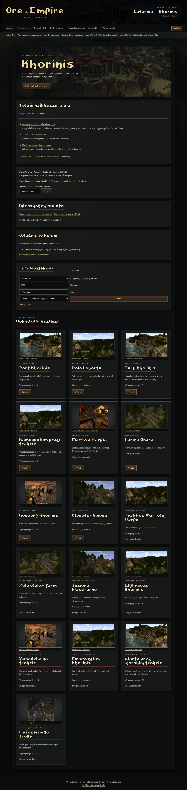
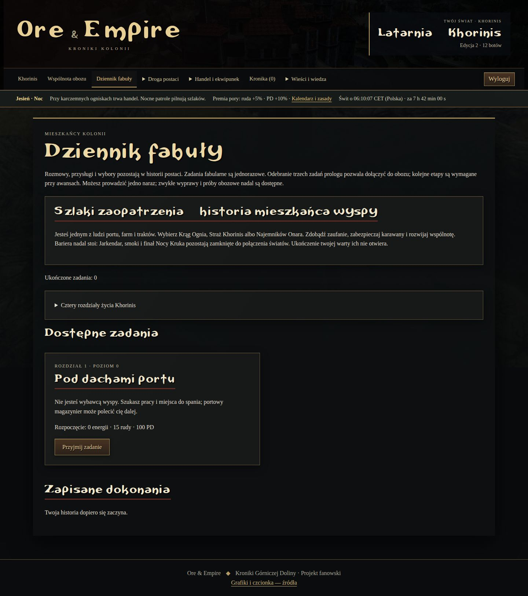
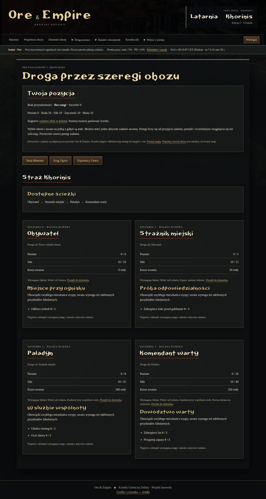
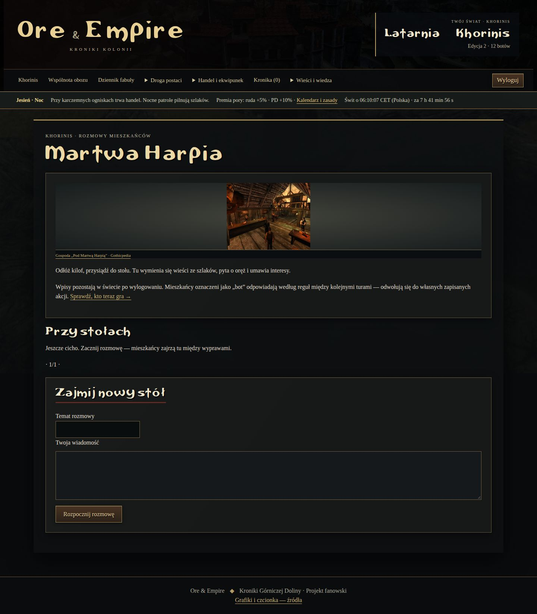
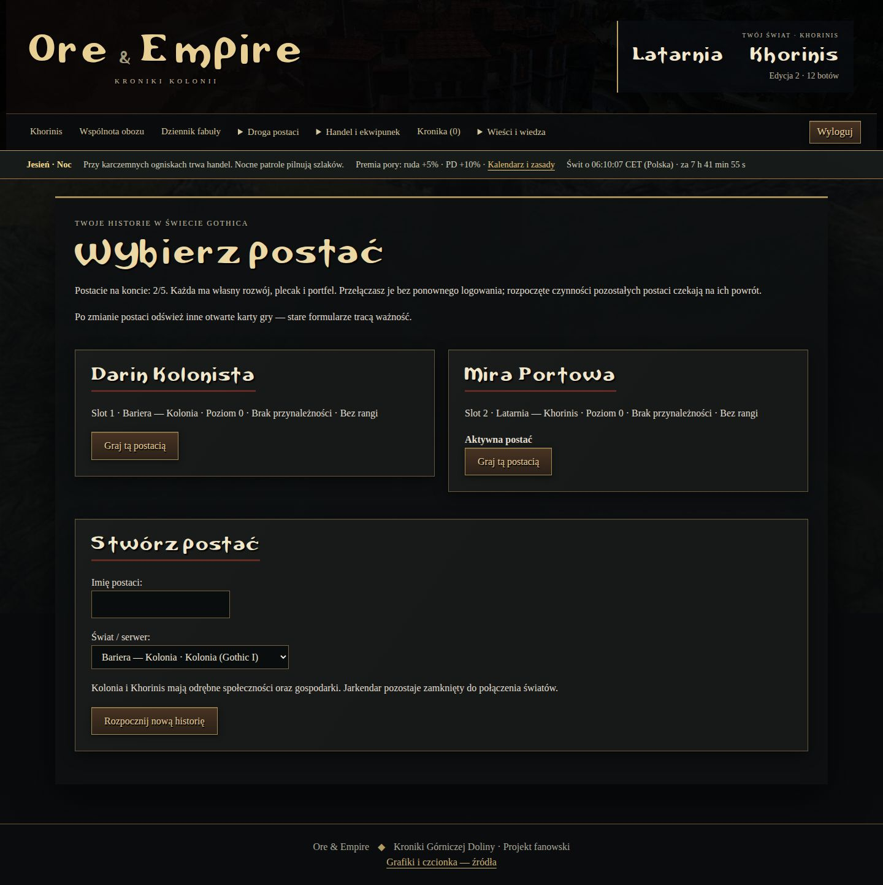
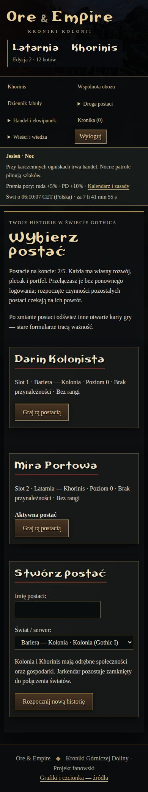

**9 listopada 2026, migracja 0042:** 40 ujęć w manifeście. Odświeżono sklep, ekran rang i wspólnotę; dodano kreator oraz jego mobilne ujęcie. „Bariera — Kolonia” to odrębny świat testowy z 12 botami i syntetycznymi postaciami Darin/Mira. Stan Darina służy kontroli przywilejów, nie dowodzi naturalnego przejścia. Chromium sprawdza 12 kombinacji czterech stron i trzech szerokości; wszystkie 17 kart sklepu mają jedną ilustrację/nagłówek. Sprawdzono przełączenie na Mirę i blokadę dołączenia bez prologu. [Raport kontroli](reports/postacie-fabula-przywileje-2026-11-09.json).

**9 listopada 2026, migracja 0041:** odświeżono sklep odłamków, życie kolonii oraz panel zarządcy; dodano mobilny sklep. Świat „Kolonia siedmiu osobowości — test”, 100 botów i syntetyczny zarządca poziomu 10 z nadanymi odłamkami służą wyłącznie kontroli GUI. Test Chromium obejmuje 320/390/1440 px, brak błędów JS, poziomego przewijania i brakujących obrazów, a także nadanie dwóch Pradawnych egzemplarzy +0. Hasła i prywatny zapis nie są publikowane.

Starszy zestaw 37 ujęć z dwóch osobnych światów testowych, każdy ze 100 botami: „Kolonia nad Wisłą” (`Skazaniec_Pokazowy`) i „Dolina Wędrowców — próba gry solo” (`Wedrowiec_Samotnik`). Nie zawiera danych prywatnego administratora.

**8 listopada 2026, migracja 0038:** odświeżono ekwipunek, kuźnię, targ, kupca i porównywarkę wraz z trzema mobilnymi odpowiednikami. Dodano dziennik zleceń i pięć osobnych kart. Motyw `zlecenia-i-rzadkosc-5`. `Zbrojmistrz_Proba` to jawny syntetyczny zestaw do porównania pięciu rzadkości; poziom 30, zasoby i Pradawny +3 nie pochodzą z przejścia. Osobny zwykły gracz testował nowe zlecenie bez nadań. Starsze ekrany zachowują własną datę w manifeście.

**8 listopada 2026, bez nowej migracji:** odświeżono kolonię, kupca z filtrami, nauczyciela z umiejętnościami, polowanie z prognozą, karczmę, życie kolonii i mobilną kolonię. Postać tego zestawu jest zwykłym graczem na poziomie 1, rozwiniętym w przeglądarce bez darów administratora. Motyw `gra-solo-i-buildy-4`.

**7 listopada 2026, migracja 0037:** odświeżono siedem ujęć — ekwipunek,
kuźnię Pradawnego +3, targ, porównywarkę oraz trzy odpowiedniki mobilne.
Motyw `rzadkosc-i-kuznia-3`. Rzadkość jest stała, a przekucie kończy się na +3.
Pełne ujęcia ekwipunku i porównywarki pokazują filtry, ochronę oraz parametry;
targ pokazuje widoczne okno (mobilny po przewinięciu do filtrów). Starsze ujęcia
pozostałych ekranów pochodzą z tego samego dnia i wcześniejszych migracji/motywów.

Kontrola GUI: 1440×1000, 390×844 i 320×844. W przeglądarce wykonano trzy
przekucia Pradawnego egzemplarza bez zmiany jego rzadkości oraz sprawdzono filtr
targu i brak formularza +4. [Raport](reports/rzadkosc-kuznia-gui-2026-11-07.json).
Hashe i czas wykonania każdego pliku są w `screenshots/manifest.json`.

## Kolonia i eksploracja

## Ekwipunek i ekonomia

## Historia, wspólnota i kalendarz

## Powtarzalne warty od poziomu 30

## Telefon

Źródła użytych ilustracji: [ASSETS.md](ASSETS.md), pełny lokalny [manifest](../characters/static/characters/gothicpedia.json). Nazwy, licencjonowanie treści wiki i prawa do obrazów gry nie są tym samym; zachowujemy przypisania źródeł.

## Rozbudowane zlecenia i oprawy rzadkości

| Runiczny — magiczna ruda | Pradawny — stare złoto |
| --- | --- |
|  |  |

## Audyt nowego gracza — 11 listopada 2026

Nowa postać Khorinis po zwykłym prologu i zakupie napoju za zarobiony odłamek. Bez nadanych statystyk i portfela; 84 widoki obu światów sprawdzone na 320/390/1440 px.

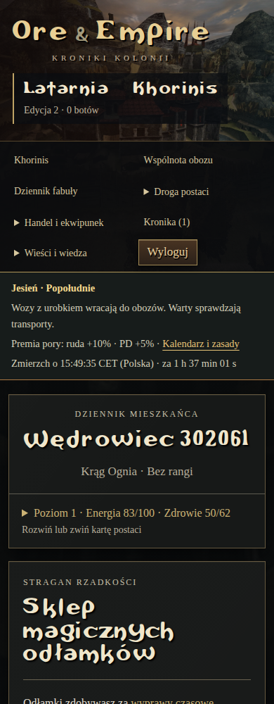
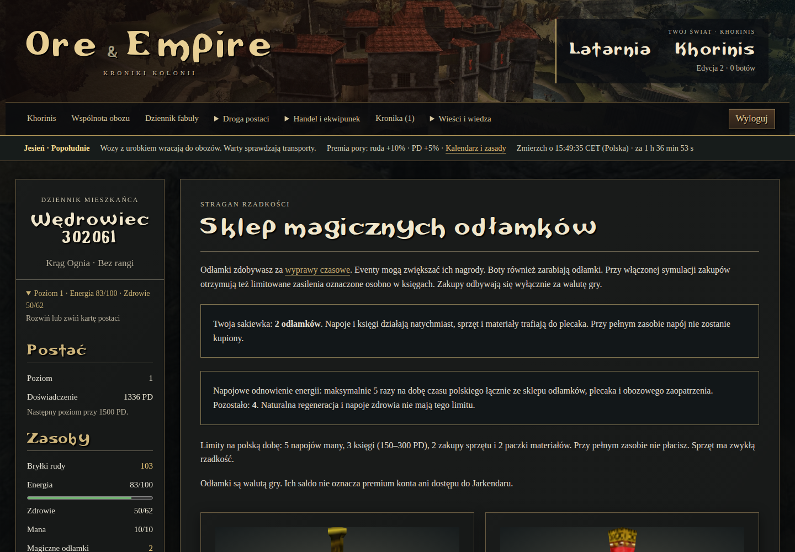

## Bariera i podróże — etap #120

Aktualne widoki [telefon 390 px](screenshots/bariera-390.png) i [desktop 1440 px](screenshots/bariera-1440.png) po rzeczywistym ostatnim ciosie przez formularz i atomowym przejściu na osobnej bazie. Statystyki końca gry oraz wcześniejszy wkład były przygotowanym syntetycznym fixture, nie organicznym przejściem kampanii. [Raport](reports/sniacy-polaczenie-2026-11-11.json) obejmuje również 320 px, podróże, kreator, wspólnotę, ranking, targ i fabułę.

## Świeży start po połączeniu — #31

11 listopada 2026: 52 ujęcia w manifeście. Kreator jednego świata z wyborem Kolonii/Khorinis, 390 i 1440 px. Oddzielna baza, nowe konto, postacie poziomu 1/0 bez nadań; samo połączenie jest fixture. Brak danych prywatnego zapisu.

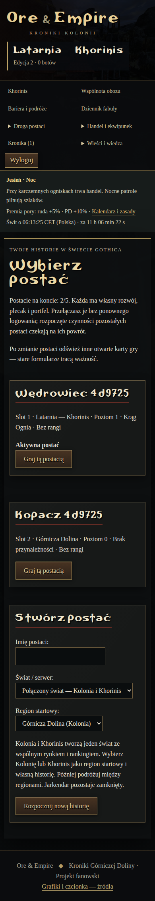

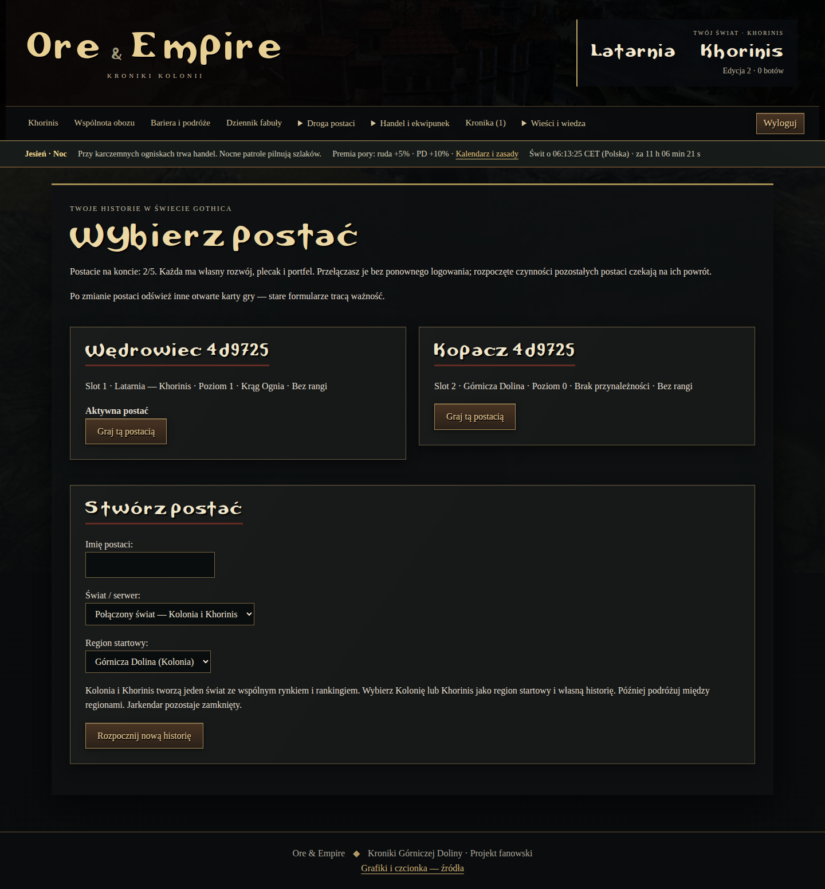

## Równe rangi — #124

54ujęcia w manifeście. Nowe ekrany pokazują zgodność starej drogi Wody (390px) i podstawową straż Khorinis (1440px). Oddzielna baza0048; postacie syntetyczne poziomu25 z maną55, bez botów. To kontrola GUI, nie organiczna kampania. Dziewięć widoków przy320/390/1440 bez overflow, błędówJS i brakujących obrazów.

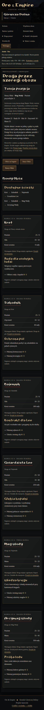

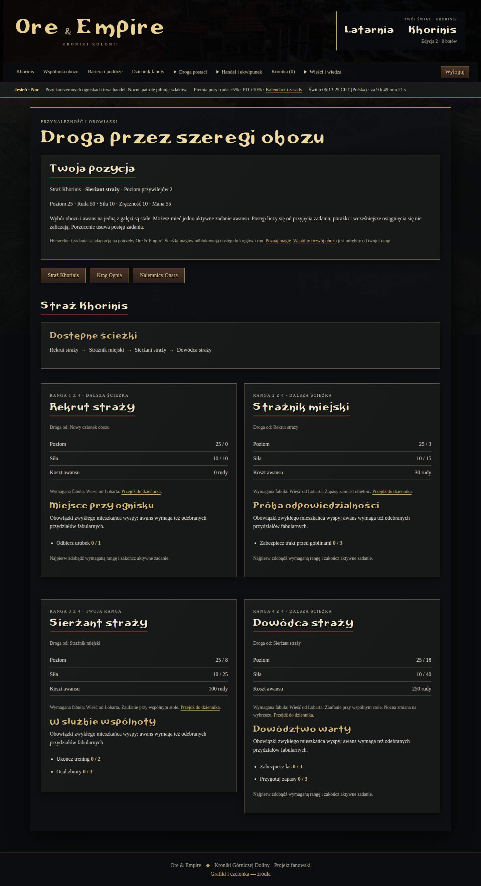
